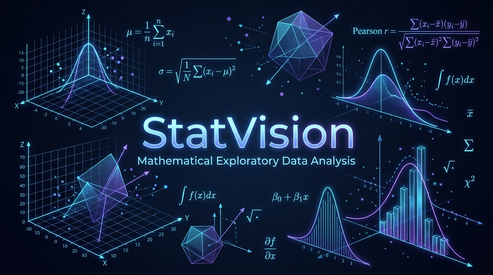

<p align="center">
  
</p>

<div align="center">

# 📚 StatVision 📈

[](https://statvision-taak.onrender.com)
[](https://python.org)
[](https://flask.palletsprojects.com/)
[](https://plotly.com/javascript/)
[](https://hub.docker.com/r/ajaygangwar945/statvision)

### 🌐 **[Live Demo](https://statvision-taak.onrender.com)** 🌐

*StatVision transforms raw tabular datasets and CSV matrices into instant, interactive mathematical insights, distribution densities, and regression diagnostics with zero lag.*

</div>

---

## 📖 About The Project

**StatVision** is a web-based Exploratory Data Analysis (EDA) and Quantitative Intelligence tool designed to help students, researchers, and data professionals understand their datasets immediately. 

Instead of writing repetitive Python scripts or Jupyter notebooks to inspect summary statistics and plot charts, you can simply upload any CSV dataset or choose a benchmark sample. StatVision instantly breaks down the data topology, calculates mathematical moments, identifies data quality issues, and renders interactive statistical charts in real time.

---

## ✨ Features

- **📂 Easy Data Ingestion**: Drag and drop any CSV or tabular file, or select pre-loaded benchmark datasets to get started right away.
- **📐 Dataset Topology**: Instant overview of total rows (N), feature dimensions (p), numerical columns, categorical factors, and missing entry counts.
- **🧮 Mathematical Moments & 5-Number Summary**: Automatic calculation of Mean, Variance, Standard Deviation, Standard Error, and quantiles ($x_{\text{min}}, Q_1, \text{Median } Q_2, Q_3, x_{\text{max}}$).
- **🔍 Automated Statistical Diagnostics**:
  - **Missing Values**: Highlights incomplete columns and null counts.
  - **Skewness Detection**: Flags left/right skewed distributions and recommends transformations.
  - **Pearson Correlation**: Automatically identifies strong positive and negative linear dependencies based on your adjustable correlation threshold slider.
- **📊 Interactive Visualizations**:
  - **Distribution Histograms**: Probability density charts with dynamic Mean and Median guideline overlays.
  - **Quantile Boxplots**: Identify outliers and spread with jittered observation points.
  - **Correlation Heatmap**: Visual matrix of pairwise feature correlations.
  - **Bivariate Regression Scatter Plots**: Interactive scatter plots with on-the-fly Ordinary Least Squares (OLS) trendlines, Pearson $r$, and $R^2$ values.
  - **Categorical Projections**: Bar charts with customizable aggregations (Mean, Median, Sum, Standard Deviation) and category limits.
- **📥 Export Summary Metrics**: Download the calculated mathematical moments and quantile summary table as a CSV with a single click.
- **🌓 Theme & Responsive Design**: Seamless switching between Light and Dark modes with an animated mathematical background, fully responsive for desktop, tablet, and mobile.

---

## 🚀 Quick Start

### Option 1: Run with Docker (Recommended)

Run the pre-built, production-ready container directly from Docker Hub:

```bash
docker run -d -p 5000:5000 --name statvision ajaygangwar945/statvision:latest
```

Open your browser and navigate to: **`http://localhost:5000`**

---

### Option 2: Local Python Installation

#### Prerequisites

- Python 3.10 or higher
- Git

#### Installation Steps

1. **Clone the repository:**

   ```bash
   git clone https://github.com/ajaygangwar945/StatVision.git
   cd StatVision
   ```

2. **Create and activate a virtual environment:**

   ```bash
   python3 -m venv venv
   source venv/bin/activate       # On Linux/macOS
   # or
   venv\Scripts\activate          # On Windows
   ```

3. **Install dependencies:**

   ```bash
   pip install -r requirements.txt
   ```

4. **Launch the application:**

   ```bash
   python app.py
   ```

   *Or run with Gunicorn:*

   ```bash
   gunicorn --bind 0.0.0.0:5000 app:app
   ```

5. Access the app at **`http://localhost:5000`**.

---

## ☁️ Deployment

### Live Application on Render

StatVision is deployed and running live at:
🔗 **[https://statvision-taak.onrender.com](https://statvision-taak.onrender.com)**

### Deploy Your Own Instance to Render.com (Free)

1. Fork or push this repository to your GitHub account.
2. Sign in to **[Render.com](https://render.com)** and create a **New Web Service**.
3. Select your **`StatVision`** repository.
4. Set the configuration:
   - **Environment:** `Python 3`
   - **Build Command:** `pip install -r requirements.txt`
   - **Start Command:** `gunicorn app:app`
5. Click **Create Web Service**.

---

## 🛠️ CI/CD with GitHub Actions

StatVision features an automated GitHub Actions pipeline (`.github/workflows/docker-publish.yml`):

- Triggers on every push to the `main` branch.
- Builds the production Docker image.
- Automatically pushes the image to **`ajaygangwar945/statvision:latest`** on Docker Hub.

---

## 📊 Technical Architecture

```
StatVision/
├── .github/
│   └── workflows/
│       └── docker-publish.yml    # Automated Docker Hub CI/CD pipeline
├── static/
│   ├── css/style.css             # Glassmorphic UI tokens & 3D math universe
│   ├── js/app.js                 # Reactive Plotly visualizers & upload controllers
│   └── images/
│       ├── banner.png            # GitHub README banner image
│       └── logo.png              # Brand identity
├── templates/
│   └── index.html                # Single-page application template
├── Dockerfile                    # Lightweight Python 3.10 slim container image
├── .dockerignore                 # Container build context filter
├── .gitignore                    # Environment & credential ignore rules
├── documentation.txt             # Comprehensive technical retrospective
├── requirements.txt              # Application dependencies
└── app.py                        # REST API & statistical calculation core
```

---

## 📡 REST API Reference

| Method | Endpoint | Description |
| --- | --- | --- |
| `GET` | `/` | Serves the main web application UI. |
| `GET` | `/api/sample/<name>` | Loads bundled benchmark datasets (`iris`, `tips`). |
| `POST` | `/api/upload` | Uploads a CSV/TSV/TXT file and returns computed statistics and plot vectors. |
| `POST` | `/api/export-moments` | Generates and downloads a CSV of the five-number summary and mathematical moments. |

---

## 👤 Author

**Ajay Gangwar**  

- GitHub: [@ajaygangwar945](https://github.com/ajaygangwar945)  
- Docker Hub: [ajaygangwar945](https://hub.docker.com/u/ajaygangwar945)
